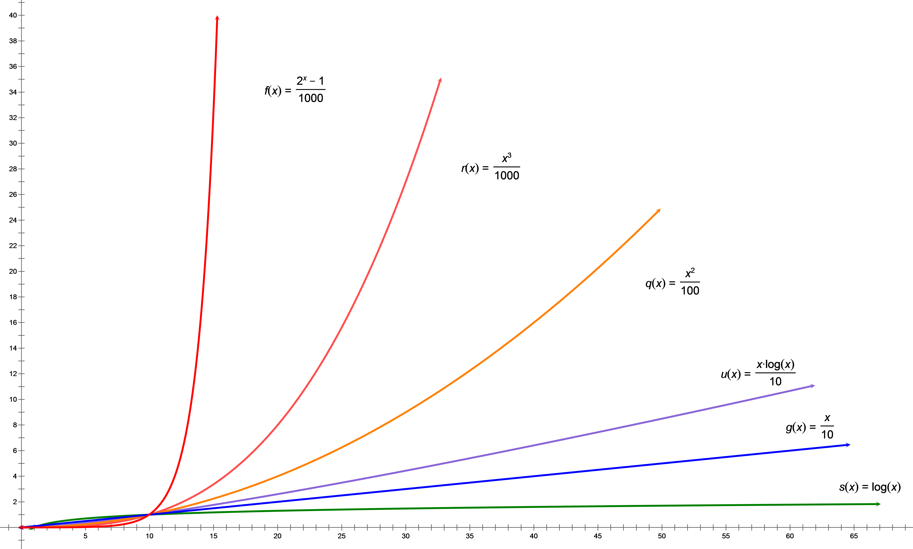

# Introduction to Data Structures (in Go)
　　We are going to discuss several classic data structures, though not with the ambition of writing a full treatise on the subject. Many excellent books already exist. Compared with formal proof-heavy exposition, the goal here is to provide a more intuitive description. Go is chosen simply because it helps keep the code direct and uncluttered.

## What We Mean by Data Structure
　　By "data structure" we mean the **storage structure**, the **logical structure**, and the **algorithms** used to maintain and exploit them. The same logical structure may be built on different storage structures, as with various heaps; the same storage structure may also support different logical structures, as with ordered and unordered arrays. In the chapters that follow, linked lists and trees are discussed mainly from the storage-structure side, heaps and hash tables mainly from the logical-structure side, while arrays and graphs lean more toward algorithms.

## On Algorithmic Complexity
　　Once algorithms enter the discussion, algorithmic complexity cannot be avoided.  
　　Algorithmic complexity measures execution cost, not how hard an implementation is to write. We usually discuss both time and space complexity. Roughly speaking, they reflect the algorithm's consumption of processor and memory resources, which are the main costs of execution. Besides average cost, worst-case cost often matters as well, because practical applications may depend on those guarantees. Space complexity is often fairly obvious; the part that usually requires real analysis is time complexity. Unless stated otherwise, the word "complexity" below refers specifically to time complexity.  
　　In general, complexity grows with input size. Let `N` denote the input size and `k` a positive integer. Common complexity classes include `O(1)`, `O(logN)`, `O(Nk)`, `O(2N)`, and combinations such as `O(NlogN) = O(N) × O(logN)`. When `N` becomes large, the gap between these classes is astonishing. If `O(logN)` is a stove flame, then `O(Nk)` is more like explosives, while `O(2N)` begins to resemble nuclear fission. As for `O(1)`, it is special: the cost does not depend on input size at all, which makes it the lowest level.

The figure below shows the growth curves of `O(logN)`, `O(N)`, `O(NlogN)`, `O(N2)`, `O(N3)`, and `O(2N)`.  

　　A systematic treatment of complexity theory would take quite a bit of space, so we will stop here. Interested readers can fill in the rest on their own.

---
[Contents](../../README.md)　[Next Chapter](1.md)
