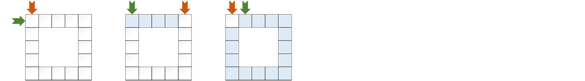

# Arrays
 1. [Basic Sorting](1A.md)
 2. [Merge Sort](1B.md)
 3. [Quick Sort](1C.md)
 4. [Radix Sort](1D.md)

___
　　An array is essentially one contiguous storage region. Any element can be reached quickly by computing its address offset, which is what "random access" really means. Because contiguity must be preserved, growing an array often requires allocating new space and copying the old contents over, which is somewhat extravagant.

　　That same continuity is also what gives arrays good locality during searching and traversal. Processor caches tend to work well with them. Many linked structures do not lose in asymptotic complexity, but once real execution begins, frequent pointer jumps can easily consume that advantage. The main weakness of arrays lies in insertion and deletion in the middle, because one local change often forces a large suffix of elements to move.

```go
func InsertTo[T any](list []T, pos int, val T) []T {
    if pos < 0 || pos > len(list) {
        panic("illegal pos")
    }
    list = append(list, val)
    for i := len(list)-1; i > pos; i-- {
        list[i] = list[i-1]
    }
    list[pos] = val
    return list
}

func EraseFrom[T any](list []T, pos int, keepOrder bool) []T {
    if pos < 0 || pos >= len(list) {
        panic("illegal pos")
    }
    last := len(list) - 1
    if keepOrder {
        for i := pos; i < last; i++ {
            list[i] = list[i+1]
        }
    } else {
        list[pos] = list[last]
    }
    return list[:last]
}
```
　　For an unordered array, insertion and deletion are both quite easy (`O(1)` time), but for an ordered array they require a fair amount of shuffling (`O(N)` time).

　　The `keepOrder` parameter in `EraseFrom` captures a very common tradeoff in array operations. If preserving the original order is unnecessary, the last element can simply be moved into the hole. If order must be preserved, then the suffix has to be shifted honestly. The former is fast, the latter is safe; which one to choose depends on the use case.

## Binary Search
　　Ordered arrays have a special advantage for searching: they can finish the job in `O(logN)` time.
```go
func Search[T cmp.Ordered](list []T, key T) int {
    for a, b := 0, len(list); a < b; {
        m := (a+b) / 2
        switch {
            case key > list[m]: a = m + 1
            case key < list[m]: b = m
            default: return m           
        }
    }                           //find the position of key
    return -1                   //return -1 if not found
}
```

　　This form uses a left-closed, right-open interval `[a, b)`. When the loop ends, `a` is exactly the position where the target should be. That makes it suitable not only for simple existence checks, but also for boundary-style queries such as "the first position greater than or equal to some value" or "the last position less than or equal to some value." The auxiliary code `SearchFirstGE`, `SearchLastLE`, and `SearchRange` is written in exactly that style.

# Circular Queues


　　A queue can also be implemented on top of an array. This kind of queue forms a ring, and the actual capacity is one less than the length of the underlying array.
```go
type queue[T any] struct {
    r, w  int       //read and write cursors
    space []T       //underlying array
}

func (q *queue[T]) init(size int) {
    if size < 7 {
        size = 7
    }
    q.space = make([]T, size+1)
    q.r, q.w = 0, 0
}

func (q *queue[T]) IsEmpty() bool {
    return q.r == q.w
}

func (q *queue[T]) IsFull() bool {
    return (q.w+1)%len(q.space) == q.r
}
```

　　The reason one slot is deliberately left empty is so that the "empty" and "full" states can be distinguished using only the read and write cursors. If the underlying array were completely filled, then `r == w` could mean either empty or full, which would make the representation ambiguous. In the current implementation, `r == w` clearly means empty, while `(w+1)%len(space) == r` clearly means full. The test becomes simple, and the only price is one sacrificed storage slot.

　　The real point of a circular queue is not the "circle" itself, but the repeated reuse of linear storage. As long as both cursors wrap around by modular arithmetic, the space freed by dequeued elements at the front can later be reused by newly enqueued elements, without the frequent bulk shifting that an ordinary sequential queue would need.

---
[Contents](../../README.md)　[Next Chapter](2.md)　[Next Section](1A.md)
