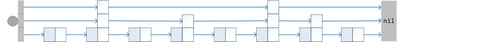

# Skip Lists
　　Ordinary linked lists have no special advantage in searching, but with the right modification a linked list can also achieve `O(logN)`-level search performance.

## Multi-level Links


　　The defining feature of a skip list is that each node has several pointer fields, which together form multiple levels of links with different densities.
```go
type bNode[T cmp.Ordered] struct {
    next []*bNode[T]        //multiple pointer fields
}
type lNode[T cmp.Ordered] struct {
    bNode[T]
    key T
}
type skipList[T cmp.Ordered] struct {
    bNode[T]                //head
    size        int
    floor, ceil int         //non-zero, current capacity bounds of this level
    magic       uint32      //random state
    knots       []*bNode[T] //temporary storage
}
```
　　The auxiliary implementation in this repository is not even strictly "one node per element." The bottom-level leaf nodes also pack a small number of ordered elements, which reduces the total node count and slightly improves the access efficiency of the linked structure.

## Jump Searching
　　Using these multi-level links, the search starts from a sparse upper level and jumps forward:
```go
func (l *skipList[T]) Search(key T) bool {
    knot, node := &l.bNode, (*lNode[T])(nil)
    for i := len(l.next) - 1; i >= 0; i-- {
        for node = knot.next[i].asLeaf(); node != nil && node.key < key; node = knot.next[i].asLeaf() {
            knot = &node.bNode
    }   }
    return node != nil && node.key == key
}
```
　　Searching always walks the higher levels first and then descends level by level. In essence, it exchanges a small number of "shortcuts" for a shorter search path.

　　A search benchmark on a list of 50,000 elements makes it clear that this jumping style is qualitatively different from an ordinary linked list:
```
LinkedList: 3.7722158s
SkipList:   7.0004ms
```

## The Victory of Speculation
　　The core idea of a skip list is to use asymmetric nodes to build multi-level links. But how should the level of each node be determined? This problem is about as awkward as choosing partition points in array quicksort. So after fixing the macroscopic proportion of higher-level nodes, we once again ask the dice for help.
```go
func (l *skipList[T]) Insert(key T) bool {
    node := l.search(key)
    if node != nil && node.key == key {
        return false
    }

    level := 1
    for level < len(l.next) &&
        l.rand() <= (math.MaxUint32/uint32(LevelFactor)) {
        level++             //speculation decides the node level
    }
    node = newLeaf[T](level)
    node.key = key
    for i := 0; i < level; i++ {
        node.next[i] = l.knots[i].next[i]
        l.knots[i].next[i] = &node.bNode
    }

    l.size++
    if l.size == l.ceil {   //upgrade
        l.floor = l.ceil
        l.ceil *= LevelFactor
        l.next = append(l.next, nil)
        l.knots = append(l.knots, nil)
    }
    return true
}
```
　　In other words, a skip list does not insist that every level be arranged perfectly. It only requires that, statistically speaking, higher-level nodes become sparser and sparser. The random promotion in the code is doing exactly that.

## Advanced Topic
　　Average `O(logN)` search performance alone is not enough to make a skip list dominant among strong competitors. Still, as a member of the linked-list family, a skip list is comparatively easy to use for sequential traversal and lock-free parallelism (even though the implementation shown here does not specifically focus on that), and in some scenarios it can have advantages over tree structures.  

---
[Contents](../../README.md)　[Previous Section](2B.md)　[Chapter Start](2.md)
