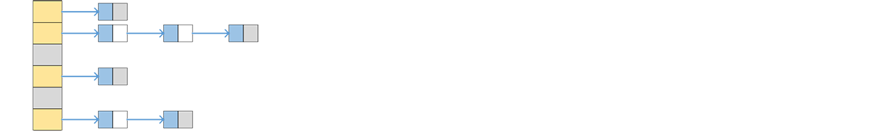

# Chained Hash Tables


## Capacity through Tolerance
　　One mainstream idea for resolving hash collisions is tolerance: all colliding elements can simply be hung together in a linked list.

```go
type node = linkedlist.Node[string]

type hashSet struct {
    bucket    []*node       //table space
    size      int
    nextLine  int           //marks the next old-table row to process
    oldBucket []*node       //old table, non-empty only during rehashing
}
```
　　Of course, we cannot let such lists grow without bound, otherwise lookup efficiency would collapse. So we must constrain the load factor and enlarge the table base in time. Rehashing is therefore necessary, and here the rehashing process is spread across subsequent insert, delete, and search operations.

```go
func (s *hashSet) Insert(key string) bool {
    code := hash(key)
    index := code % uint32(len(s.bucket))
    conflict := search(s.bucket[index], key)
    if s.isMoving() {                           //during rehashing
        if !conflict {                          //try searching the old table
            index := code % uint32(len(s.oldBucket))
            conflict = search(s.oldBucket[index], key)
        }
        s.moveLine()                            //advance the rehashing progress
    }
    if !conflict {
        unit := new(node)
        unit.Val = key
        unit.Next, s.bucket[index] = s.bucket[index], unit
        s.size++
        if !s.isMoving() && s.isCrowded() {     //check whether the load factor is too high
            idx := array.SearchSuccessor(primes, uint32(len(s.bucket)))
            if idx < len(primes) {
                s.resize(primes[idx])           //expand, i.e. rehash all elements into a larger table
        }   }
        return true
    }
    return false
}
```
　　In other words, once expansion begins, the table does not stop everything and move the entire old table in one shot. Instead, each later operation carries one line along with it. This makes the fluctuation of a single operation much smaller.

　　Correspondingly, when deleting elements we consider shrinking the table base. With suitable upper and lower bounds for the load factor, we can avoid requesting a new rehash while the current rehash is still in progress.

```go
func (s *hashSet) Remove(key string) bool {
    code, done := hash(key), false
    index := code % uint32(len(s.bucket))
    s.bucket[index], done = remove(s.bucket[index], key)
    if s.isMoving() {
        if !done {                              //try deleting from the old table
            index = code % uint32(len(s.oldBucket))
            s.oldBucket[index], done = remove(s.oldBucket[index], key)
        }
        s.moveLine()                            //advance the rehashing progress
    }
    if done {
        s.size--
        if !s.isMoving() && s.isWasteful() {
            idx := array.SearchFirstGE(primes, uint32(len(s.bucket))) - 1
            if idx >= 0 {
                s.resize(primes[idx])           //shrink
    }   }   }
    return done
}
```
　　The good side of this design is that it is simple to implement and stable in behavior. The bad side is that lookup inside one heavily loaded slot may still have to walk down a list in the worst case.

---
[Contents](../../README.md)　[Previous Section](3.md)　[Next Section](3B.md)
