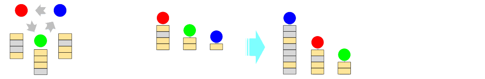

# Multi-way Hash Tables


## A Cautious Hare Keeps Several Burrows
　　Another important idea for resolving hash collisions is to spread the risk. By distributing elements among subtables that use different hash functions, we can hope that the probability of one element colliding in all subtables at once stays low.

```go
type node struct {      //element node
    code [4]uint32
    key  string
}
type hashSet struct {
    buckets [4][]*node  //multiple subtables
    master  int         //current master table id
    size    int
}
```
　　We organize the subtables into a ring and make their capacities decrease. This arrangement gives some convenience during expansion.

```go
func (s *hashSet) init() {
    s.master, s.size = 0, 0
    size := 2                   //2^n
    for i := 3; i >= 0; i-- {
        size *= 2               //doubling in reverse means halving forward
        s.buckets[i] = make([]*node, size)
}   }

func (s *hashSet) expand() {
    s.master = (s.master + 3) % 4
    oldBucket := s.buckets[s.master]
    bucket := make([]*node, len(oldBucket)<<4)
    for _, unit := range oldBucket {
        if unit != nil {
            pos := mod(unit.code[s.master], len(bucket))
            bucket[pos] = unit  //after this large expansion, collision is impossible
    }   }
    s.buckets[s.master] = bucket
}
```
　　Only the current master table is expanded here, and it is expanded quite aggressively in one go. The purpose is not gentle incremental growth, but rather to make sure that the freshly expanded subtable can absorb the elements kicked out of other places.

## Relay
　　When inserting an element, it is not enough to let only the newcomer try its luck among several subtables. We also need to mobilize elements that are already inside. Concretely, when element A collides with element B in subtable 1, A does not merely turn to subtable 2; instead, B is kicked out and B then seeks a landing spot in subtable 2.

```go
func (s *hashSet) Insert(key string) bool {
    if s.find(key, false) { return false }
    s.size++
    unit := new(node)
    unit.key = key
    unit.code = hash(key)
    for obj, age := unit, 0; ; age++ {
        for idx, trys := s.master, 0; trys < 4; idx = (idx + 1) % 4 {
            bucket := s.buckets[idx]
            pos := mod(obj.code[idx], len(bucket))
            if bucket[pos] == nil {
                bucket[pos] = obj           //found an empty slot
                return true                 //done
            }
            obj, bucket[pos] = bucket[pos], obj
            if obj == unit {
                trys++                      //count wraparound
        }   }
        if age > 0 {                        //set a threshold here to limit expansions
            panic("too many conflicts")     //in reality this still cannot solve massive hash collisions
        }
        s.expand()                          //placement failed by wraparound, so expand
    }
    return false
}
```
　　This is the so-called cuckoo-style placement: the newcomer kicks out the resident, and the resident then goes to look elsewhere. As a result, any single element can end up only in a limited number of candidate positions, so even in the worst case lookup has to check only those positions.

## Compared with Chaining
　　A multi-way hash table is much more complicated than a chained hash table, and it is less stable and reliable. In exchange, however, it can guarantee the worst-case lookup time of a single element.

---
[Contents](../../README.md)　[Previous Section](3A.md)　[Next Section](3C.md)
