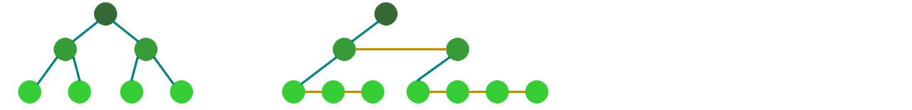

# Trees
 1. [AVL Trees](4A.md)
 2. [Red-Black Trees](4B.md)
 3. [Weak AVL Trees](4C.md)
 4. [B+ Trees](4D.md)
 5. [Radix Trees](4E.md)

___


　　A tree is a hierarchical structure: there is one root node, and then the structure branches outward.  
```go
type Node[T any] struct {
    key         T
    left, right *Node[T]
}
```
　　The power of a tree lies in turning a "before-and-after relation" into a "hierarchical relation." When data naturally carries branching and containment, trees are often far better than linear structures at organizing efficient search paths.

　　Sometimes we want to reach sibling nodes directly, or we want to save storage when a node has many branches. In that case, we may use a linked-list style to record sibling nodes.
```go
type Node[T any] struct {
    key   T
    child *Node[T]    //points to the eldest child
    peer  *Node[T]    //sibling-node list (a doubly linked list would also work)
}
```
　　So a tree may emphasize either "how many children in fixed directions a node has" or "a chain of successors hanging off each node." The balanced trees, B+ trees, and dictionary trees discussed in the following sections are all developments along these different directions.

## Binary Search Trees
```
        4
       / \
      2   5
     / \   \
    1   3   6
```
　　A binary search tree is a logical structure built on top of a binary tree. It requires that the left child, the parent, and the right child form an ordered relation, so that a search for a given value can start from the root and proceed downward. Searching and insertion in a binary search tree are relatively easy, but deletion takes more effort. When the target node has two children, deleting it directly raises the problem of where those children should go. In that case, we find the target node a stand-in: one of the two nodes with values closest to it. The stand-in clearly cannot still have two children of its own, so we delete the stand-in and leave its value behind in the target node.
```go
func (tr *NaiveBST[T]) Remove(key T) bool {
    target, parent := tr.root, (*node[T])(nil)
    for target != nil && key != target.key {
        if key < target.key {
            target, parent = target.left, target
        } else {
            target, parent = target.right, target
    }   }
    if target == nil { return false }               //not found

    var victim, orphan *node[T]
    switch {
    case target.left == nil:
        victim, orphan = target, target.right
    case target.right == nil:
        victim, orphan = target, target.left
    default:                                        //need a stand-in
        victim, parent = target.right, target
        for victim.left != nil {                    //take the inorder successor (or predecessor)
            victim, parent = victim.left, victim
        }
        orphan = victim.right
    }

    if parent == nil {                              //here victim == target
        tr.root = orphan
    } else {
        if victim.key < parent.key {
            parent.left = orphan
        } else {                                    //inherit the parent's position
            parent.right = orphan
        }
        target.key = victim.key                     //transplant the value
    }
    return true
}
```
　　This also shows that the core difficulty of deleting from a binary search tree is not "removing one node," but "preserving inorder order after the removal." All the balanced trees that follow are, in essence, built by maintaining balance on top of that basic requirement.

---
[Contents](../../README.md)　[Next Chapter](5.md)　[Next Section](4A.md)
