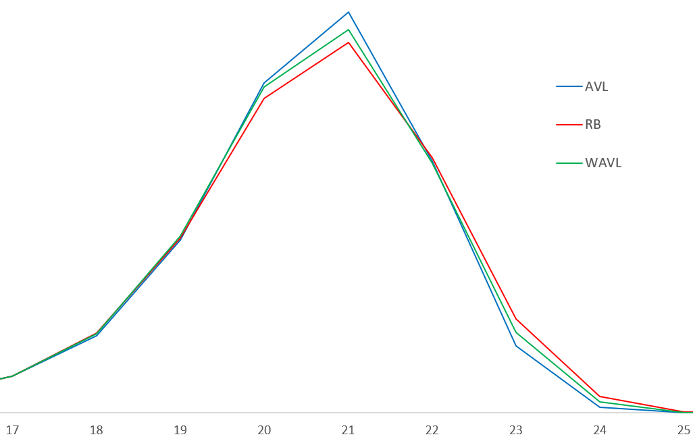
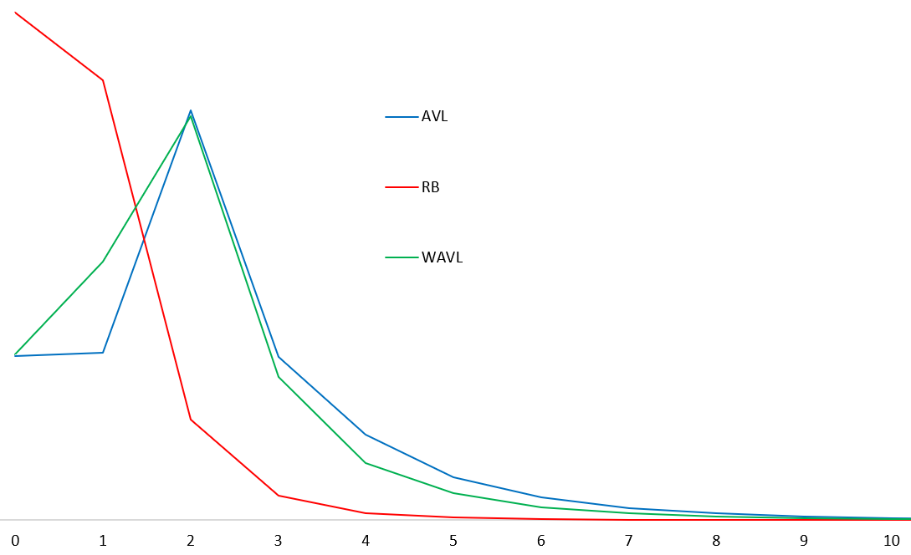
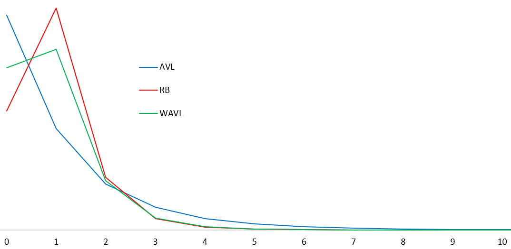

# Weak AVL Trees
　　AVL trees impose fairly strong constraints, to the point that deletion may require `O(logN)` structural transformations, which is worse than the red-black tree in that respect (though in actual use AVL trees are not necessarily slower overall than red-black trees without compressed balance metadata). To address that regret, weakened AVL variants were developed.
```go
type node[T cmp.Ordered] struct {
    diff   [2]uint8    //height differences to the child subtrees
    key    T
    parent *node[T]
    kids   [2]*node[T]
}
```
Weak AVL tree nodes separately record the logical height differences to their two children, and must satisfy the following three rules:

　　• The height of `nil` is `-1`.

　　• When a node is a leaf (both children are `nil`), its height must be `0`.

　　• The height difference between a node and each child is either `1` or `2`.

Compared with an AVL tree, the weakened constraints relax the following two points:

　　• The height difference between a non-leaf node and `nil` may be `2`.

　　• A non-leaf node may have height difference `2` to both its left and right children (the AVL balance factor can represent only the three cases `1:2`, `1:1`, and `2:1`).

### Why It Exists
　　Obviously, an AVL tree already satisfies the constraints of a weak AVL tree. It can also be shown that a weak AVL tree can be transformed into a red-black tree (see the relevant literature; we will not expand on that here). So a weak AVL tree is a data structure that lies between AVL trees and red-black trees.  

　　Put differently, a weak AVL tree is trying to find a new midpoint between "tighter balance" and "cheaper adjustment."

## Insertion and Rebalancing
```
----------------LL---------------    -----------------LR----------------
|    X0 - P      |       X        |    |      X0 - P     |        Z        |
|   / \    \     |      / \       |    |     / \    \    |      /   \      |
| Y1   \    \    |    Y1   P1     |    |    /   Z1   \   |    X1     P1    |
|       \    \   |        /  \    |    |   /   /  \   \  |   /  \   /  \   |
|        Z2   S2 |      Z1    S1  |    | Y2   a    b  S2 | Y1    a b    S1 |
```
Weak AVL insertion resembles AVL insertion, but the rebalancing process is different and the balance updates are less intuitive.
```go
func (tr *Tree[T]) rebalanceAfterInsert(P *node[T], trace uint64) {
    for {
        Xside := trace & 1
        Sside := 1 - Xside
        if P.diff[Xside]--; P.diff[Xside] > 0 { break } //stop if no correction is needed
        super, root := P.parent, (*node[T])(nil)
        if P.diff[Sside] == 1 {
            P.diff[Xside], P.diff[Sside] = 1, 2
            if P = super; P == nil { break }
            trace >>= 1
            continue                                    //trace upward to fix heights
        }
        if X := P.kids[Xside]; X.diff[Xside] == 1 {
            P.kids[Xside] = P.Hook(X.kids[Sside])
            X.kids[Sside] = X.hook(P)
            P.diff[Xside], P.diff[Sside], X.diff[Sside] = 1, 1, 1
            root = X                                    //LL(RR)
        } else {
            Z := X.kids[Sside]
            X.kids[Sside], P.kids[Xside] = X.Hook(Z.kids[Xside]), P.Hook(Z.kids[Sside])
            Z.kids[Xside], Z.kids[Sside] = Z.hook(X), Z.hook(P)
            X.diff[Sside], P.diff[Xside] = Z.diff[Xside], Z.diff[Sside]
            X.diff[Xside], P.diff[Sside] = 1, 1
            Z.diff[Xside], Z.diff[Sside] = 1, 1
            root = Z                                    //LR(RL)
        }
        if super == nil {
            tr.root = super.hook(root)
        } else {
            super.kids[(trace>>1)&1] = super.hook(root)
        }
        break
}   }
```
　　Because it records height differences on both sides, rebalancing must take several interacting difference values into account at the same time. That is why it looks more roundabout than an ordinary AVL tree.

## Deletion and Rebalancing
```
----------------LL----------------    ----------------LR----------------
|       P        |       S         |    |       P        |        Z        |
|      / \       |      / \        |    |      / \       |       / \       |
|    S1   \      |     /   \       |    |     S1  \      |      /   \      |
|   /  \   \     |    /     P1+    |    |    / \   \     |     /     \     |
| Y1    \   \    |  Y2     /  \    |    |   /   Z1  \    |    S2      P2   |
|       Z?   \   |       Z?    \   |    |  /   / \   \   |   /  \    / \   |
|             X3 |             X2- |    | Y2  a   b   X3 |  Y1   a  b   X1 |
```
Deletion is somewhat complicated, but the whole process needs only one structural transformation, even fewer than the red-black tree.
```go
func (tr *Tree[T]) rebalanceAfterRemove(P *node[T], trace uint64) {
    if P.kids[Left] == nil && P.kids[Right] == nil {
        P.diff[Left], P.diff[Right] = 1, 1      //leaf nodes need special handling
        if super := P.parent; super == nil {
            tr.root = super.Hook(P)
            return
        } else {
            P = super
            trace >>= 1
    }   }
    for {
        Xside := trace & 1
        Sside := 1 - Xside
        if P.diff[Xside]++; P.diff[Xside] == 2 {
            break                               //stop if no correction is needed
        }
        super, root := P.parent, (*node[T])(nil)
        if P.diff[Sside] == 2 {
            P.diff[Sside], P.diff[Xside] = 1, 2
            goto Lcascade                       //case 1 of upward height correction
        }
        if S := P.kids[Sside]; S.diff[Sside] == 2 {
            if S.diff[Xside] == 2 {
                S.diff[Sside], S.diff[Xside], P.diff[Xside] = 1, 1, 2
                goto Lcascade                   //case 2 of upward height correction
            }
            Z := S.kids[Xside]
            S.kids[Xside], P.kids[Sside] = S.Hook(Z.kids[Sside]), P.Hook(Z.kids[Xside])
            Z.kids[Sside], Z.kids[Xside] = Z.hook(S), Z.hook(P)
            S.diff[Xside], P.diff[Sside] = Z.diff[Sside], Z.diff[Xside]
            S.diff[Sside], P.diff[Xside] = 1, 1
            Z.diff[Sside], Z.diff[Xside] = 2, 2
            root = Z                            //LR(RL)
        } else {
            X, Z := P.kids[Xside], S.kids[Xside]
            S.kids[Xside] = S.hook(P)
            P.diff[Sside], S.diff[Xside] = S.diff[Xside], 1
            S.diff[Sside], P.diff[Xside] = 2, 2
            if Z == nil {
                P.kids[Sside] = nil
                if X == nil {                   //leaf nodes need special handling
                    S.diff[Xside], P.diff[Sside], P.diff[Xside] = 2, 1, 1
                }
            } else {
                P.kids[Sside] = P.hook(Z)
            }
            root = S                            //LL(RR)
        }
        if super == nil {
            tr.root = super.hook(root)
        } else {
            super.kids[(trace>>1)&1] = super.hook(root)
        }
        break
    Lcascade:
        if P = super; P == nil { break }
        trace >>= 1
}   }
```
　　This complexity does not come for free. Once the constraints are relaxed, the probability of long-range cascading adjustments during deletion drops. That is precisely the intended improvement over the AVL tree.

## Performance Evaluation
The benchmark method uses one round of insertion, then two-thirds deletion, two-thirds successful lookup, and one-third unsuccessful lookup.

| Operation | SkipList | B+ Tree | RB-Tree | AVL-Tree | WAVL-Tree |
| :-------|:----:|:----:|:----:|:----:|:----:|
| Insert | 24.65ms | 12.59ms | 19.71ms | 20.92ms | 19.66ms |
| Search | 23.96ms | 10.18ms | 12.27ms | 11.53ms | 12.11ms |
| Remove | 16.91ms | 8.51ms | 10.07ms | 10.21ms | 10.48ms |

In the test on one hundred thousand random integers, the B+ tree shows a clear advantage in insertion, the three binary-tree families each have their own strengths, and the skip list falls behind across the board.

| Operation | SkipList | B+ Tree | RB-Tree | AVL-Tree | WAVL-Tree |
| :-------|:----:|:----:|:----:|:----:|:----:|
| Insert | 506.90ms | 175.64ms | 425.14ms | 420.90ms | 425.22ms |
| Search | 560.65ms | 147.18ms | 287.62ms | 278.46ms | 286.28ms |
| Remove | 421.95ms | 119.71ms | 316.01ms | 287.45ms | 294.77ms |

In the test on one million random integers, the B+ tree crushes the competition, while the skip list continues to lag behind.  
With its better balancing, the AVL tree edges out the red-black tree slightly, while the weak AVL tree lands between the two.

### Closer Tracing
Tracking the depth distribution of nodes in a tree with ten million nodes shows that the AVL tree really is more balanced than the red-black tree, though the advantage is not spread across a very wide range.

Tracking the number of upward retrace steps needed after insertion in a tree with ten million nodes shows the red-black tree winning by a large margin, while the weak AVL tree behaves close to the AVL tree.

Tracking the number of upward retrace steps needed after deletion in a tree with ten million nodes shows that the red-black tree and the weak AVL tree concentrate within three steps, while the AVL tree is more spread out.

### Evaluation Summary
　　The skip list has a fairly large gap from balanced trees in core lookup performance, and at present there seems to be little hope of a surprise comeback.  
　　At large scales, the B+ tree is the uncontested performance king, though it does not belong to the binary-search-tree family, as the next section will explain.  
　　The contest between AVL trees and red-black trees has a long history. In truth, the number of structural adjustments during deletion has only a tiny influence on the final outcome; the larger factors are balance quality itself and the maintenance cost of the balancing metadata. Statistically speaking, the red-black tree has a better rebalancing process than the AVL tree, though that advantage may still be offset by weaker balance.

---
[Contents](../../README.md)　[Previous Section](4B.md)　[Next Section](4D.md)
