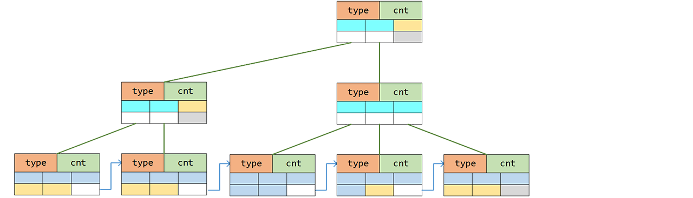

# B+ Trees


　　In Chapter Two we already discussed one way to improve the storage friendliness of linked structures, namely blockification. This section applies the same idea to trees.
```go
type bNode[T cmp.Ordered] struct {
    inner bool                      //true means internal node, false means leaf node
    view  []T                       //data window, points to the derived type's data field
}
type iNode[T cmp.Ordered] struct {
    bNode[T]                        //inner==true
    data     [iFullSize]T           //index keys
    kids     [iFullSize]*iNode[T]   //child-pointer area (not type-safe, may actually point to leaves)
}
type lNode[T cmp.Ordered] struct {
    bNode[T] //inner==false
    data     [lFullSize]T           //payload
    next     *lNode[T]              //linked-list pointer area
}
```
　　A B+ tree consists of index nodes and storage nodes, forming a perfectly balanced multi-way tree. In an index node, each index value is the maximum value contained in the corresponding child subtree. The storage nodes, which are also the leaves of the tree, additionally form an ordered block list.

　　It no longer insists that each node hold only one key. Instead, one node packs a whole batch of keys. That noticeably lowers the tree height and correspondingly reduces the number of random accesses.
```
       [3  6  9]
      /    |    \
[1 2 3] [4 5 6] [7 8 9]
```

## When Full, Split
```
                                                                         [5 9]
                                                                         /   \
       [3  6  9]         =>        [3     6     9]        =>        [3  5]   [6  9]
      /    |    \                  /     / \     \                  /   |     |   \ 
[0 1 2] [3 4 5] [6 8 9]      [1 2 3] [4 5] [5 6] [7 8 9]      [1 2 3] [4 5] [5 6] [7 8 9]
```
　　When inserting a new element into a full node, we split that node into two:
```go
func (tr *Tree[T]) Insert(key T) bool {
    if tr.root == nil {
        //...
    }
    tr.path.Clear()
    node, pos := tr.root, 0
    if key > tr.root.ceil() {                           //above the upper bound
        for node.inner {
            pos = len(node.view) - 1
            node.data[pos] = key                        //update all the way along the path
            tr.path.Push(trait[T]{node, pos})
            node = node.kids[pos]
        }
        pos = len(node.view)
    } else {
        for node.inner {
            pos = array.SearchFirstGE(node.view, key)
            if key == node.view[pos] { return false }
            tr.path.Push(trait[T]{node, pos})           //trace the path
            node = node.kids[pos]
        }
        pos = array.SearchFirstGE(node.view, key)
        if key == node.view[pos] { return false }
    }

    peer := node.asLeaf().insert(pos, key).asIndex()
    for peer != nil {                                   //a new peer node split out, continue
        if tr.path.IsEmpty() {
            //...
        } else {
            last := tr.path.Pop()
            last.node.view[last.idx] = node.ceil()
            node, peer = last.node, last.node.insert(last.idx+1, peer)
    }   }
    return true
}
```
　　The implementation fixes index values along the path on the way back because internal B+ tree nodes do not store split positions themselves, but summaries of subtree upper bounds. Once a leaf changes, those upper bounds in its ancestors may have to change as well.

## When Sparse, Merge
```
         [4 9]                     [4 9]                   [4 9]
         /   \                     /   \                   /   \
    [2  4]   [6  9]      =>    [2 4]  [6  9]      =>     [4] [6  9]      =>     [4  6  9]
    /   |     |   \            /  |    |   \             /    |   \             /   |   \ 
[1 2] [3 4] [5 6] [7 8 9]  [1 2] [4] [5 6] [7 8 9]  [1 2 4] [5 6] [7 8 9]  [1 2 4] [5 6] [7 8 9]
```
　　After deleting an element, we try to deal with nodes whose remaining payload becomes too small: either merge them with nearby nodes or borrow data from nearby nodes.
```go
func (tr *Tree[T]) Remove(key T) bool {
    //...
    node.asLeaf().remove(pos)
    if tr.path.IsEmpty() {                                  //direct deletion when at the root
        if len(node.view) == 0 {
            tr.root, tr.head = nil, nil
        }
        return true
    } //other than the root case, len(node.view) >= 2
    shrink, ceil := (pos == len(node.view)), node.ceil()    //extra index correction needed

    last := tr.path.Pop()                                   //small payload, consider merging nodes
    for limit, isLeaf := lQuarterSize, true; len(node.view) < limit; limit, isLeaf = iQuarterSize, false {
        peer := node
        if last.idx == len(last.node.view)-1 {              //look backward
            node = last.node.kids[last.idx-1]
        } else {                                            //look forward
            last.idx++
            peer, shrink = last.node.kids[last.idx], false
        }
        combined := false
        if isLeaf {
            combined = node.asLeaf().combine(peer.asLeaf())
        } else {
            combined = node.combine(peer)                  //try to merge
        }
        last.node.view[last.idx-1] = node.ceil()           //fix the index
        if !combined { break }                             //stop
        last.node.remove(last.idx)
        if tr.path.IsEmpty() {
            if len(last.node.view) == 1 {                  //shrink the root
                tr.root = last.node.kids[0]
            }
            return true
        }
        node = last.node
        last = tr.path.Pop()
    }
    if shrink {                                             //merging ended, but index correction is unfinished
        last.node.view[last.idx] = ceil
        for last.idx == len(last.node.view)-1 &&            //cascade upward
            !tr.path.IsEmpty() {
            last = tr.path.Pop()
            last.node.view[last.idx] = ceil
    }   }
    return true
}
```
　　The reason deletion in a B+ tree looks so wordy is precisely that it must preserve not only the search-tree property, but also a roughly "not too empty" load state for every block.

## Performance Analysis
　　A B+ tree is the ideal student in the sense that search, insertion, and deletion are all `O(logN)`. The split and merge operations on nodes do involve some data movement, so there is real overhead. Even so, as the benchmark in the previous section already shows, a B+ tree is often faster than binary search trees in practice. The root cause is that random memory access behaves poorly, and block-like structures often outperform purely linked ones.

---
[Contents](../../README.md)　[Previous Section](4C.md)　[Next Section](4E.md)
