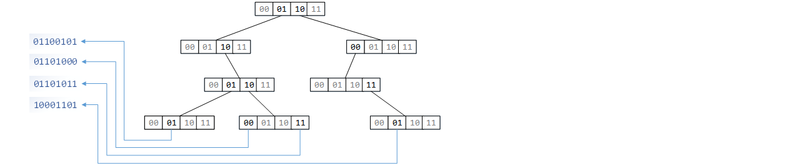
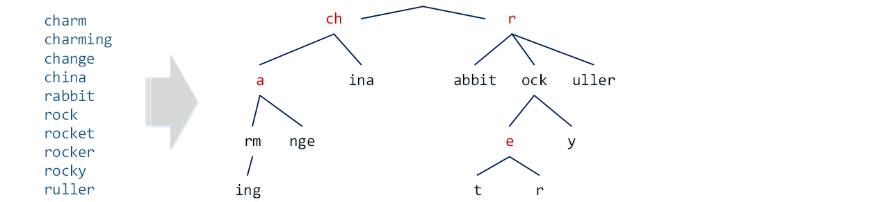

# Radix Trees


　　A radix tree is a simple and efficient hierarchical index structure in which each level indexes one fragment of the key.
```go
type node struct {
    kids [Radix]unsafe.Pointer
}

func branch(key uint, depth uint) uint {
    return (key >> (bitWidth - (depth+1)*Step)) & Mask
}
```
　　As long as each fragment of the key can be extracted directly, the search path is determined accordingly. There is no need to keep comparing magnitudes the way a binary search tree does.

　　Operations on a radix tree are relatively simple. During deletion, we only need to pay attention to cascading cleanup.
```go
func (m *Map) Remove(key uint) bool {
    var path [Depth]*node
    path[0] = &m.root
    for i := uint(0); i < Depth-1; i++ {
        path[i+1] = (*node)(path[i].kids[branch(key, i)])
        if path[i+1] == nil { return false }
    }
    idx := key & Mask
    if path[Depth-1].kids[idx] == nil { return false }
    path[Depth-1].kids[idx] = nil
    for i := Depth - 1; i != 0; i-- {
        j := uint(0)
        for j < Radix && path[i].kids[j] == nil { j++ }
        if j == Radix { //completely empty
            path[i-1].kids[branch(key, i-1)] = nil
    }   }
    return true
}
```
　　Because the branch choice at each level is determined directly by bit slicing, a radix tree feels more like drilling down to a fixed depth than performing a search in the comparison-based sense.

# Tries


　　A trie, also called a prefix tree, is an index structure for sequences. Its basic principle is the same as that of a radix tree, but since sequence lengths are not fixed, the situation becomes more complicated. On the other hand, we usually want the data unit to be a meaningful fragment (preferably not smaller than one byte), which means a node may have many successors, so obtaining good space utilization becomes a challenge. Trie node structures come in many flavors, each with its own strengths, and the separated pointer-array structure introduced here strikes a balance between convenience and performance.
```go
type node struct {
    data [segCap]byte     //stores several data units
    mark uint8            //highest bit indicates whether this is a real entity; low bits store segment length
    kids []*node
}
```
　　The implementation here also compresses a short run of consecutive characters into the same node, and when there is only one branch it attempts further compaction. So this is not the most naive "one character per level" version.

　　Insertion in a trie is relatively straightforward; the main thing is to handle splitting correctly.
```go
func (t *Trie) insert(key string) bool {
    unit, skip := &t.root, uint8(0)
    unit.compact()                              //try compaction before querying
    brk := 0
    for sz := unit.mark & 0x7f; len(key) > int(sz); sz = unit.mark & 0x7f {
        brk = unit.diff(key, skip, sz)
        if brk >= 0 { goto Lsplit }
        skip = 1
        key = key[sz:]
        pos := search(unit.kids, key[0])
        if pos >= len(unit.kids) || unit.kids[pos].data[0] != key[0] {
            unit.kids = array.InsertTo(unit.kids, pos, createTail(key))
            return true                         //add a new branch at the articulation node
        }
        unit = unit.kids[pos]
        unit.compact()                          //try compaction before querying
    }
    brk = unit.diff(key, skip, uint8(len(key)))
    if brk < 0 {
        if len(key) == int(unit.mark&0x7f) {    //stop at an articulation node, just mark it
            done := (unit.mark & 0x80) == 0
            unit.mark |= 0x80
            return done
        } else {                                //single split
            unit.kids = []*node{unit.split(len(key))}
            unit.mark |= 0x80
            return true
    }   }
Lsplit:                                         //double split
    kid1 := createTail(key[brk:])
    kid2 := unit.split(brk)
    if kid1.data[0] > kid2.data[0] {
        kid1, kid2 = kid2, kid1
    }
    unit.kids = []*node{kid1, kid2}
    return true
}
```
　　The key point of insertion is not simply hanging new nodes all the way downward. It is that when two strings share only a partial fragment, the common prefix and the diverging suffixes must be separated again.

　　Deletion, meanwhile, has to consider how to remove non-shared sequence fragments.
```go
func (t *Trie) remove(key string) bool {
    knot, branch := (*node)(nil), -1            //track the articulation for deletion
    unit, skip := &t.root, uint8(0)
    unit.compact()
    for sz := unit.mark & 0x7f; len(key) > int(sz); sz = unit.mark & 0x7f {
        if (unit.mark&0x80) != 0 || len(unit.kids) > 1 {
            knot = unit
        }
        if unit.diff(key, skip, sz) >= 0 { return false }
        skip = 1
        key = key[sz:]
        pos := search(unit.kids, key[0])
        if pos >= len(unit.kids) || unit.kids[pos].data[0] != key[0] {
            return false
        }
        if knot == unit { branch = pos }
        unit = unit.kids[pos]
        unit.compact()
    }
    if (len(key)|0x80) == int(unit.mark) &&
        unit.diff(key, skip, unit.mark&0x7f) < 0 {
        if len(unit.kids) == 0 && knot != nil { //delete a non-shared sequence fragment
            knot.kids = array.EraseFrom(knot.kids, branch, true)
        } else {
            unit.mark &= 0x7f
        }
        return true
    }
    return false
}
```
　　By tracking "the last articulation point that is still shared," deletion can, after removing the target word, conveniently snip away the tail that served only that word.

---
[Contents](../../README.md)　[Previous Section](4D.md)　[Chapter Start](4.md)
