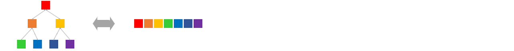

# Binary Heaps


　　A binary heap does not use a traditional tree-shaped storage structure. Instead, it chooses a tree-shaped logical structure built on top of an array.

　　That is exactly what makes it so practical: the tree relations are preserved only logically, while physically the data remains one contiguous array, and parent-child positions can be computed directly by index arithmetic.

## Rising and Sinking
　　We know that a heap is a convergence of ordered chains, so the ordering inside those chains has to be maintained. In this section we use the "bubble" style to maintain that order.
```
          2                    2                    1               2      2      1
        /   \                /   \                /   \             |      |      |
      4       5     =>     4       1     =>     4       2           5  =>  1  =>  2
     / \     / \          / \     / \          / \     / \          |      |      |
    9   7   6  _1_       9   7   6   5        9   7   6   5         1      5      5
```
　　Each chain has only `O(logN)` length, so bubbling upward takes `O(logN)` time. In the code, the element is not swapped upward step by step. Instead, the target value is first saved aside, then smaller parents are shifted down along the path, and finally the target is dropped into place all at once.
``` 
         _7_                   2                    2               7      2      2
        /   \                /   \                /   \             |      |      |
      2       5     =>     7       5     =>     4       5           2  =>  7  =>  4
     / \     / \          / \     / \          / \     / \          |      |      |
    9   4   6   8        9   4   6   8        9   7   6   8         4      4      7
``` 
　　The sinking process must first perform one horizontal comparison in order to decide the path, so the number of comparisons is `O(2logN)`. That is also one source of the relatively large constant factor of a binary heap.

## Building Up
　　We can build a binary heap from an unordered array by working bottom-up:
```go
func (hp *Heap[T]) BuildInPlace(list []T) {
    size := len(list)
    hp.vec = list
    for idx := size/2 - 1; idx >= 0; idx-- {
        hp.down(idx)
}   }
```
　　Heap construction has complexity only `O(N)`:
```
If building a binary heap of height logX costs O(f(logX)), then f(logX+1) = 2f(logX) + 1
Clearly f(0) = 0, so by induction f(logX) = X - 1
```
## Push & Pop
　　Pushing into a binary heap means appending a new element at the tail and then adjusting it:
```go
func (hp *Heap[T]) Push(unit T) {
    place := len(hp.vec)
    hp.vec = append(hp.vec, unit)
    hp.up(place)
}
```
　　After popping the top element from a binary heap, we bring in the tail element to fill the gap and then adjust it:
```go
func (hp *Heap[T]) Pop() T {
    size := hp.Size()
    if size == 0 {
        panic("empty heap")
    }
    unit := hp.vec[0]
    if size == 1 {
        hp.vec = hp.vec[:0]
    } else {
        hp.vec[0] = hp.vec[size-1]
        hp.vec = hp.vec[:size-1]
        hp.down(0)
    }
    return unit
}
```

## Heap Sort
　　We can use a binary heap to improve selection sort and reduce its complexity to `O(NlogN)`:
```go
func HeapSort(list []int) {
    BuildMaxHeap(list)                          //build a max heap
    for sz := len(list) - 1; sz > 0; sz-- {
        list[sz] = Pop(list[:sz+1])             //repeatedly select the maximum from the remaining part
}   }
```
　　The core of heap sort is a series of sinking operations, whose total number of comparisons is `O(2NlogN)`, inferior to merge sort and quicksort. Although heap construction cost also matters, the main reasons heap sort tends to be slower than its peers are still the extra comparison per step and its irregular memory-access pattern.

　　Also, heap sort is in-place but not stable. Once elements are pulled close to the top of the heap, their original relative order is usually lost.


---
[Contents](../../README.md)　[Previous Section](5.md)　[Next Section](5B.md)
